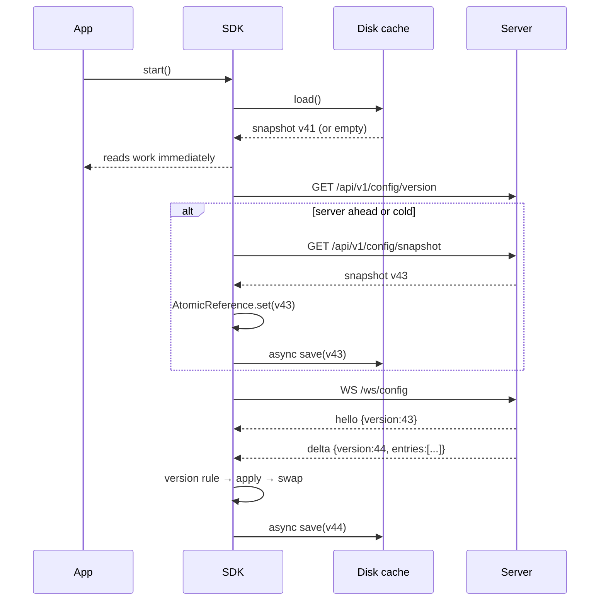

# SDK Design — Embedded Configuration Client

The SDK is the only thing services talk to at request time. It is a plain Java 21 library:
Jackson for JSON, and the JDK's `HttpClient` and `WebSocket` for transport. It drags no
framework into a consuming service and adds two runtime dependencies (`jackson-databind`,
`slf4j-api`).

---

## 1. Lifecycle

```
                 cache hit
   ┌──────────┐   (instant)   ┌──────────┐   hello/snapshot   ┌────────┐
   │ CREATED  │──────────────▶│ SYNCING  │───────────────────▶│  LIVE  │
   └────┬─────┘               └────┬─────┘                    └───┬────┘
        │ start()                  │ HTTP snapshot                 │ socket drop
        │                          ▼                               ▼
        │                     ┌──────────┐   retry + jitter   ┌──────────┐
        │                     │ DEGRADED │◀───────────────────│RECONNECT │
        │                     └────┬─────┘                    └────┬─────┘
        │                          │ version poll heals            │
        │                          └───────────────────────────────┘
        ▼
   ┌──────────┐
   │  CLOSED  │  flushes cache, closes socket, stops schedulers
   └──────────┘
```

- **CREATED → SYNCING**: `start()` loads the disk cache synchronously (so the first read is
  already correct), schedules the version poll with zero initial delay, and opens the
  WebSocket.
- **SYNCING → LIVE**: the first successful snapshot (from the poll or the stream) makes the
  SDK live. Until then, cached data is already servable.
- **LIVE → DEGRADED**: the socket drops or a sync fails. Reads keep working; the reconnect
  loop uses backoff and the poll keeps trying.
- **CLOSED**: idempotent. Flushes pending cache writes.

`start()` and `close()` are idempotent and thread-safe.

---

## 2. Bootstrap and reads



A read is `state.resolve(key, context)`: three hash lookups (`SHIFT`, `OFFICE`, `CLIENT`)
plus a definition lookup for the global default. No locks, no allocation beyond the small
result record, no network.

### Authentication and tenancy

The SDK sends its API key on every REST call and on the WebSocket upgrade:

```java
ConfigSdk.builder()
        .baseUrl("http://config-server:8080")
        .apiKey(System.getenv("CONFIG_API_KEY"))
        .clientId("acme-corp")
        ...
```

The server binds the connection to that key's tenant and filters every snapshot and delta
before it reaches the socket. The SDK therefore never holds another tenant's overrides, and a
compromised service cannot read across tenants even if it guesses an office id. An invalid key
surfaces as repeated sync failures with no state applied; the last cached snapshot keeps
serving reads.

---

## 3. Version rules

| Incoming | Action | Counter |
| --- | --- | --- |
| `version == current + 1` | Apply, rebuild state, atomic swap | `deltasApplied` |
| `version == current` | Ignore (duplicate frame) | `staleIgnored` |
| `version < current` | Ignore (stale / out-of-order) | `staleIgnored` |
| `version > current + 1` | Gap: state untouched, request snapshot | `gapsDetected` |
| Snapshot `version >= current` | Replace whole state | `resyncs` |
| Snapshot `version < current` | Ignore (never regress) | `staleIgnored` |

All transitions happen inside `StateApplier`, serialised on one monitor. Readers only touch
the `AtomicReference`, so they never observe a half-applied change set.

---

## 4. Threading model

| Thread | Work |
| --- | --- |
| Caller threads | `get`, `resolve`, `explain`, `stats` — lock-free reads |
| `config-sdk` scheduler (2 threads, daemon) | Version poll and reconnect scheduling |
| JDK HTTP client executor | WebSocket callbacks; deltas applied inline |
| `config-sdk-cache` (1 thread, daemon) | Coalescing disk writes |

Callbacks from `ConfigEventListener` may run on transport threads; keep them short and
non-blocking.

---

## 5. Disk cache

- File name defaults to `config_cache.json` in the working directory; configurable, and
  disableable with `cacheFile(null)`.
- Writes are **asynchronous and coalescing**: only the newest state is persisted; rapid
  deltas do not queue up.
- Every write lands in a temp file and is moved into place atomically, so a crash cannot
  leave a torn file. A corrupt file is logged and ignored, not fatal.
- The cache stores the same JSON as `GET /api/v1/config/snapshot`, so it can be inspected
  with `jq` or replayed by hand.

---

## 6. Reconnect and staleness bounds

```
wait = min(30 s, 500 ms × 2^attempt) + random(0, 500 ms)
```

The jitter is what prevents 500 restarting services from reconnecting in lockstep. Attempts
reset when a socket opens.

Staleness is bounded by the poll interval (default 3 s): even with a dead WebSocket, a
client notices `serverVersion > localVersion` and fetches a snapshot. With a healthy socket,
propagation is sub-second; the integration test asserts < 5 s.

---

## 7. Observability hooks

`stats()` returns an immutable `SdkStats`:

```java
SdkStats stats = sdk.stats();
// version, definitions, overrides, deltasApplied, staleIgnored, gapsDetected,
// resyncs, syncFailures, reconnectScheduled, connected, lastSyncAt
```

`ConfigEventListener` offers `onUpdate`, `onGapDetected`, `onSyncFailure` and
`onConnectionStateChanged`. The SDK deliberately does not depend on Micrometer; the host
service can bind these to its own registry.

---

## 8. Failure modes

| Failure | SDK behaviour | Read correctness |
| --- | --- | --- |
| Server unreachable at start | Loads disk cache, retries with backoff | Cached values are served |
| No cache and no server | Reads throw “unknown key”; host should fail fast at startup | No data — deliberate |
| Socket drops mid-flight | Reconnects with jitter; poll heals meanwhile | Last good state |
| Frame lost | Gap detection on next frame → snapshot | State refreshed |
| Duplicate frame | Ignored by version rule | Unchanged |
| Frame arrives out of order | Older version ignored | Unchanged |
| Corrupt cache file | Warn + start empty | Refetched from server |
| Disk full on cache write | Warn, keep serving memory | Unaffected |
| Process killed | Cache already on disk (async, coalesced) | Last persisted version |

---

## 9. Extending

- New setting types only affect the server-side validator strategies; the SDK treats values
  as strings and offers typed accessors.
- Multi-tenant services should resolve per request with `get(key, new TenantContext(...))`
  until server-side tenant filtering lands.
- The wire contract is versioned by the server's snapshot/delta shape; unknown fields are
  ignored so older SDKs survive additive changes.
